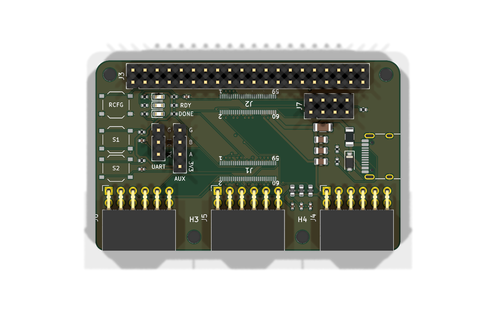

# Tang Primer 25K carrier board (open hardware)

A 4-layer carrier board for the **Sipeed Tang Primer 25K** FPGA module (Gowin GW5A-LV25). It makes the bare
module usable when Sipeed's official 25K Dock is out of stock, which in India it has been for months.

It is **pin-compatible with Sipeed's 25K Dock**: the same 40-pin header, three PMOD ports, UART and user buttons
S1/S2. Sipeed's examples and existing Dock `.cst` constraint files work unchanged. The board is powered from
USB-C and programmed through a JTAG header that uses the Dock's J7 pinout.



> **Status: designed and checked, NOT yet built.** This is an untested first prototype.
> - DRC: 0 errors, 0 unconnected; schematic parity 0. The 93 remaining warnings are documented in `PLAN.md`.
> - On 25 Nov 2026 a polarity error on the TVS diode D1 was found in JLCPCB's 3D preview and fixed (PLAN.md
>   D21). `verify_schematic.py` now checks diode polarity.
> - If you build it, please open an issue with your results, good or bad.

The whole design was produced by scripts and AI-assisted engineering (Claude), with every step checked by
KiCad's own ERC/DRC and by independent rule scripts. [PLAN.md](PLAN.md) records every fact, source and decision
(D1–D21), including the mistakes.

## Folders
| Path | What |
|---|---|
| `PLAN.md` | Plan, status, verified facts, decisions D1–D21 |
| `pinout_v2.csv` | All 120 module pins, checked against several official sources |
| `kicad/carrier_v2.kicad_pro` / `.kicad_sch` | KiCad 10 project and schematic. **Generated; don't hand-edit** (see below) |
| `kicad/carrier_v2_schematic.pdf` | Schematic PDF for reading |
| `kicad/carrier_v2.kicad_pcb` | PCB: Dock outline and placement, fully routed, pours filled. **Generated**: `gen_pcb.py` → `route_pcb.py` → `cleanup_pcb.py` |
| `kicad/*.png` | 3D renders and the F.Cu / In2.Cu / B.Cu copper |
| `kicad/drc_report.txt` | Latest full DRC report |
| `fab/carrier_v2_jlcpcb_gerbers.zip` | Gerbers plus drill, ready to upload (JLCPCB format) |
| `fab/carrier_v2_jlcpcb_bom.csv`, `fab/carrier_v2_jlcpcb_cpl.csv` | JLCPCB assembly files (every line has an LCSC part number) |
| `fab/carrier_v2_bom_mpn.csv` | Vendor-neutral BOM: manufacturer, MPN, LCSC number and polarity notes, for any assembler |
| `fab/hand_solder.csv`, `fab/ORDERING.md` | Through-hole parts to solder yourself; step-by-step order settings and checks |
| `kicad/carrier_v2.pretty/` | Project footprint: Sipeed's official DF40 socket land pattern |
| `tools/` | Generators and checkers (see below) |
| `sources/SOURCES.md` | Index of the official Sipeed, Gowin and Hirose documents used, and where to get them |
| `reference_v1/` | The old v1 pin list, kept only for comparison |

## Ordering
Read [fab/ORDERING.md](fab/ORDERING.md) first. In short:
- 4 layers, 1.6 mm, **ENIG** finish (needed for the 0.4 mm-pitch DF40 sockets).
- 0.1/0.1 mm track/space, 0.2 mm vias.
- Top-side assembly.

JLCPCB builds it as designed. Some Indian fabs (for example PCB Power) have also confirmed the design rules are
feasible. Total for 5 boards with 2 assembled was about ₹10–13k (Nov 2026).

## Board summary
- **Module:** 2× Hirose DF40C-60DS-0.4V(51) receptacles (1.5 mm stack) on Sipeed's official land pattern.
- **Power:** USB-C (power only) → 2 A fuse → +5 V, protected by an SMF5.0A unidirectional TVS diode (cathode to
  VBUS). The module's own 3.3 V output feeds VCCIO0/1, 2/3 and 6/7 through ferrite beads.
  - Keep total 3.3 V draw from the headers under about 500 mA.
- **Headers:**
  - J3: 2×20, same as Dock J3 (38 GPIO, +5 V, GND).
  - J4–J6: PMOD, same as the Dock.
  - J7: JTAG.
  - J8: UART (GND, FPGA RX = B3, FPGA TX = C3).
  - J9: AUX (IOT23A/B).
- **Configuration and buttons:**
  - READY/DONE LEDs.
  - RECONFIG button.
  - S1/S2 user buttons on H11/H10, active high (enable the FPGA pull-down in your design).
- **Programming:** the board has **no onboard USB programmer**. Use an FT2232H or CH347 USB-JTAG adapter on J7
  with openFPGALoader, or a Gowin cable.
- **Not broken out:** the module's MIPI D-PHY lanes (the Dock doesn't use them either).

## Rebuild and re-check everything
Requirements:
- KiCad 10;
- Python 3 with `pymupdf`;
- Java 17+ and [Freerouting 1.9.0](https://github.com/freerouting/freerouting/releases/tag/v1.9.0), with the
  environment variable `FREEROUTING_JAR` pointing at the jar.

**Source documents:** the vendor PDFs and CAD files are copyrighted by Sipeed, Gowin and Hirose, so they are not
in this repo. Download them into `sources/` as listed in [sources/SOURCES.md](sources/SOURCES.md). Two small
derived files are included so the PCB step works without them: `sources/sipeed_official/dock_layout.json` and
`sources/ball_map_from_schematic.csv`. `make_df40_footprint.py` needs Sipeed's footprint file; the generated
footprint is already in `kicad/carrier_v2.pretty/`.

Run these from `tools/`. The paths assume KiCad's default Windows install, so adjust them on Linux or macOS.
```bash
python build_pinout.py
python make_df40_footprint.py
python gen_schematic.py
"C:\Program Files\KiCad\10.0\bin\kicad-cli.exe" sch upgrade ..\kicad\carrier_v2.kicad_sch
python verify_schematic.py
"C:\Program Files\KiCad\10.0\bin\python.exe" gen_pcb.py
"C:\Program Files\KiCad\10.0\bin\python.exe" route_pcb.py 60
"C:\Program Files\KiCad\10.0\bin\python.exe" cleanup_pcb.py
"C:\Program Files\KiCad\10.0\bin\kicad-cli.exe" pcb drc --severity-all --schematic-parity --refill-zones -o ..\kicad\drc_report.txt ..\kicad\carrier_v2.kicad_pcb
python make_fab.py
```
What the scripts do:
- `route_pcb.py` rebuilds the board with `gen_pcb.py`, exports it, routes it with Freerouting 1.9.0, imports the
  result and fills the pours.
- `cleanup_pcb.py` removes dangling copper and fixes too-close vias, driven only by KiCad's DRC, and undoes any
  change that breaks a connection.
- `make_fab.py` writes the Gerbers, drill, BOMs and CPL into `fab/`.
- `extract_dock_layout.py` re-creates `dock_layout.json` from the Dock iBOM (needs `pip install lzstring`).

`verify_schematic.py` exits non-zero on any problem. It checks:
- ERC reports 0 violations.
- The netlist matches the generator's intent.
- Module pins match the official pinout.
- All 68 GPIOs are broken out.
- Header signals match the Dock PDF, and differential pairs sit side by side.
- The pull-up/pull-down, power, JTAG and UART rules hold.
- Diode polarity is correct.
- Every symbol pin has a pad in its footprint.

To change the design, edit `tools/gen_schematic.py` and re-run the chain.

## Licence
- Hardware design files (schematic, PCB, footprints, fabrication outputs): **CERN-OHL-P-2.0** ([LICENSE](LICENSE)).
- Scripts in `tools/` and `reference_v1/`: **MIT** ([tools/LICENSE](tools/LICENSE)).

Tang Primer, Sipeed, Gowin and Hirose are trademarks of their owners. This project is not affiliated with them.
